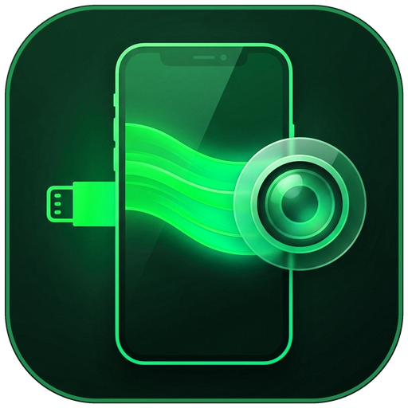

  

<h1 align="center">TJCap for Android v1.0.0</h1>

  <b>Windows 10 / 11 專用 — Android 手機／平板 USB-C 雙模免 Root 2K+ 60/120fps 虛擬擷取卡 App</b> 
  免實體擷取卡 · 免 Root · 預設免裝手機 App 直連（USB 偵錯）＋ 內附免開 USB 偵錯備援（TJCap Companion APK + USB AOA） 
  USB 速率智慧辨識 · 四欄式即時健康度儀表板 · 獨立全螢幕預覽 (`F11`) · 原畫質無損截圖 (`F12`) · 智慧故障診斷與自動更新

---

## 目錄
- [一、下載與安裝](#一下載與安裝零外部依賴開箱即用)
- [二、兩種免 Root 模式比較（該選哪一種？）](#二兩種免-root-usb-c-連線模式比較該選哪一種)
- [三、詳細使用教學 A：免裝手機 App 高速直連（預設推薦）](#三詳細使用教學-a免裝手機-app-高速直連預設推薦)
- [四、詳細使用教學 B：免開 USB 偵錯備援模式（Companion APK + USB AOA）](#四詳細使用教學-b免開-usb-偵錯備援模式companion-apk--usb-aoa)
- [五、OBS Studio / Discord / Zoom 直播與錄影設定教學](#五obs-studio--discord--zoom-直播與錄影設定教學)
- [六、直接當電腦外接大螢幕、即時監控與原畫質截圖](#六直接當電腦外接大螢幕即時監控與原畫質截圖免開-obs)
- [七、電腦耳機零延遲監聽與音訊路由教學](#七電腦耳機零延遲監聽與音訊路由教學)
- [八、USB 接口速率自動辨識與線材挑選建議](#八usb-接口速率自動辨識與最大解析度分級)
- [九、常見問題排解 (FAQ) 與故障代碼說明](#九常見問題排解-faq-與故障代碼說明)
- [十、從原始碼編譯與開源授權](#十從原始碼編譯-building-from-source)

---

## 一、下載與安裝（零外部依賴，開箱即用！）

請直接前往本專案右側的 **[Releases（發布頁面）](../../releases/latest)** 下載最新版本：

1. **📦 正式安裝版 App（最推薦）：`TJCap-for-Android-Setup-v1.0.0.exe`**
   - 雙擊執行安裝精靈，自動在**桌面**與**開始選單**建立帶有翠綠專屬圖示的 **「TJCap for Android」** App。
   - 自動完成 DirectShow 雙路虛擬擷取卡（`TJCap for Android (Video)` / `(Audio)`）與內建 ADB／AOA 驅動服務註冊（獨立 CLSID，可與 iOS 版虛擬擷取卡同時並存！）。
   - 內建 **GitHub Releases 自動更新**：日後有新版時，點 App 內 **`⬆️ 升級`** 即可自動驗算 `SHA-256` 並一鍵升級。
2. **📁 免安裝綠色便攜版 App：`TJCap-for-Android-Portable-v1.0.0.zip`**
   - **重要**：請先右鍵「全部解壓縮」至獨立資料夾（切勿直接在 ZIP 壓縮檔內點開），再雙擊資料夾內的 **`TJCap for Android.exe`** 即可使用（首次啟動會自動請求管理員權限註冊虛擬擷取卡，同樣支援便攜版一鍵自動更新）。
3. **📲 手機端備援安裝包：`TJCap-Companion-v1.0.0.apk`** *(已同步內附於電腦端程式的 `companion\` 資料夾中)*
   - **一般使用者免安裝！** 只有在您要使用「🛡️ 免開 USB 偵錯備援模式 (AOA)」時才需要傳至手機安裝。

---

## 二、兩種免 Root USB-C 連線模式比較（該選哪一種？）

| 比較項目 | ⚡ 模式一：免裝手機 App 直連（預設推薦） | 🛡️ 模式二：免開 USB 偵錯備援（Companion + AOA） |
| :--- | :--- | :--- |
| **需要 Root 嗎？** | ❌ **完全免 Root** | ❌ **完全免 Root** |
| **需要安裝手機 APK 嗎？** | ❌ **免裝任何 APK**（插線即用） | ✅ 需安裝隨附輕量 `TJCap-Companion-v1.0.0.apk` (129 KB) |
| **需要開啟「USB 偵錯」嗎？** | ✅ 僅需開啟一次「開發者選項 ➔ USB 偵錯」 | ❌ **完全免開開發者選項與 USB 偵錯！** |
| **最高畫質與幀率** | 最高 **2K+/4K (`3840p`) · `60 / 120 FPS`** | 最高 **2K+/4K (`3840p`) · `60 / 120 FPS`** |
| **系統內錄立體聲音訊** | ✅ Android 11+ 全系統原生內錄 (`48kHz`) | ✅ Android 10+ `AudioPlaybackCapture` (`48kHz`) |
| **每次啟動需在手機點確認？** | ❌ 勾選「一律允許」後，以後插線即自動出畫 | ✅ 受 Android 隱私限制，每次需點一次「開始錄製」 |
| **最推薦使用情境** | 日常直播、多數手遊（小米免開安全設定） | **會偵測並封鎖「開發者選項／USB 偵錯」的特定手遊**或公司受管手機 |

> 💡 控制台另提供 **`🔄 智慧雙模自動切換`** 選項：優先使用 ADB 直連，若偵測到手機未開 USB 偵錯則自動改走 USB AOA 配件通道。

---

## 三、詳細使用教學 A：免裝手機 App 高速直連（預設推薦）

### 步驟 1：開啟手機「開發者選項」與「USB 偵錯」（僅首次需設定）
依您的手機品牌操作（皆為 Android 官方內建功能，不影響保固、不需 Root）：

* **Samsung 三星 (One UI)**：
  1. 開啟 **設定 ➔ 關於手機 ➔ 軟體資訊**
  2. 連續點擊 **「版本號碼」7 下**（依提示輸入鎖屏密碼）
  3. 返回設定最底部點進 **「開發人員選項」** ➔ 開啟 **「USB 偵錯」**
* **Xiaomi 小米 / Redmi / POCO (HyperOS / MIUI)**：
  1. 開啟 **設定 ➔ 我的裝置 ➔ 全部參數與資訊**
  2. 連續點擊 **「OS 版本」**（或 MIUI 版本）7 下
  3. 返回 **設定 ➔ 更多設定 ➔ 開發者選項** ➔ 開啟 **「USB 偵錯」**（⚠️ 註：使用 TJCap 純畫面直播**完全不需要**開啟下方的「USB 偵錯（安全設定）」，免插 SIM 卡也能用！）
* **Google Pixel / Sony Xperia / ASUS ROG Phone / Zenfone**：
  1. 開啟 **設定 ➔ 關於手機** ➔ 連續點擊 **「版本號碼」7 下**
  2. 返回 **設定 ➔ 系統 ➔ 開發人員選項** ➔ 開啟 **「USB 偵錯」**
* **OPPO / Realme / OnePlus (ColorOS / OxygenOS)**：
  1. 開啟 **設定 ➔ 關於裝置 ➔ 版本資訊** ➔ 連續點擊 **「版本號碼」7 下**
  2. 返回 **設定 ➔ 系統設定／其他設定 ➔ 開發者選項** ➔ 開啟 **「USB 偵錯」**
  3. **建議一併將最底部的「停用權限監控 (Disable permission monitoring)」開啟**，避免系統攔截硬體編碼器啟動
* **vivo / iQOO (OriginOS / FuntouchOS)**：
  1. 開啟 **設定 ➔ 系統管理／關於手機 ➔ 軟體版本號** 連點 7 下
  2. 返回 **系統管理 ➔ 開發者選項** ➔ 開啟 **「USB 偵錯」**

### 步驟 2：連接 USB-C 並點選信任授權
1. 使用支援資料傳輸的 **USB-C 傳輸線** 將 Android 手機／平板接上電腦（建議優先插在**電腦主機板後方原生 USB 3.0 / Type-C 接口**）。
2. 手機解鎖後若跳出「**允許 USB 偵錯嗎？**」，請勾選 **「一律允許透過這台電腦進行偵錯」**，並點擊 **「允許」**。
   > 若手機未跳出視窗，請下拉手機通知列將 USB 用途從「僅充電」改為 **「檔案傳輸 (MTP)」** 即可觸發。

### 步驟 3：一鍵啟動投影擷取
1. 開啟電腦上的 **「TJCap for Android」**，上方翠綠狀態列會顯示已偵測到的裝置型號與 **USB 速率分級**（如 `⚡ USB 3.2 Gen2 (10Gbps)｜已解鎖最高 3840p`）。
2. 在控制台選擇您偏好的設定：
   - **USB-C 擷取連線模式**：保持預設 **`⚡ 免裝手機 App 直連`**
   - **最大解析度與比例選項**：推薦 **`🌟 原生極限無上限`** 或 **`💎 2K 高畫質上限`**（開始傳輸後會全程鎖定，不會在直播途中忽大忽小）
   - **目標幀率與畫面方向**：一般直播選 **`🔒 60 FPS 穩定直播模式`**，高刷手遊可選 **`⚡ 120 FPS 電競高刷模式`**
3. **先把手機轉好要直播的橫向或直向畫面**，點擊 **`🚀 智慧一鍵啟動`**，右側即時預覽即會在 1～2 秒內同步顯示畫面！

---

## 四、詳細使用教學 B：免開 USB 偵錯備援模式（Companion APK + USB AOA）

若您遊玩的手遊反外掛會要求關閉「開發者選項／USB 偵錯」，請改用此模式：

1. **安裝手機端輕量 App（僅首次）**：
   - 開啟電腦端「TJCap for Android」，點擊第一列右側的 **`📲 取得 APK`** 按鈕，會自動開啟 `companion\` 資料夾並選取 **`TJCap-Companion-v1.0.0.apk`**。
   - 將該 APK 透過檔案傳輸、雲端或通訊軟體傳到手機並安裝（手機可以**完全關閉開發者選項與 USB 偵錯**）。
2. **切換電腦端為 AOA 模式並啟動**：
   - 用 USB-C 線將手機接上電腦。
   - 在電腦端「TJCap for Android」第一列「USB-C 擷取連線模式」下拉選單切換為 **`🛡️ 免開 USB 偵錯備援（TJCap Companion APK + USB AOA）`**。
   - 點擊 **`🚀 智慧一鍵啟動`**（若首次使用 AOA 配件模式遇權限提示，點一次 **`🔧 安裝／修復驅動`** 即可無損掛載 WHQL 簽章過濾層）。
3. **在手機端點一下授權開始錄製**：
   - 電腦會自動透過 USB AOA 協定喚醒手機上的 **`TJCap Companion`** App。
   - 若跳出「允許 TJCap Companion 存取 USB 配件」請勾選一律允許並點「確定」，再點擊畫面中的綠色按鈕 **`🚀 授權螢幕錄製並開始 USB-C 直播`** ➔ 點選系統提示的「**立即開始**」即可低延遲直傳電腦與 OBS！

---

## 五、OBS Studio / Discord / Zoom 直播與錄影設定教學

### 1. OBS Studio 滿版零黑邊＋同步立體聲設定
1. **先在「TJCap for Android」點擊 `🚀 智慧一鍵啟動`**（讓虛擬擷取卡先鎖定手機原生解析度與比例）。
2. 開啟 **OBS Studio** ➔ 在「來源」視窗點 **`+`** ➔ 新增 **「視訊擷取裝置」**。
3. **裝置** 選擇：**`TJCap for Android (Video)`**。
4. **解析度/FPS 類型** 保持 **「裝置預設值」**：OBS 會自動抓取手機的 1:1 原生畫面比例（如 `2560×1180`、`3120×1440`、`2560×1440`），完全零黑邊！
   > 💡 若您先開了 OBS 才啟動 TJCap，只要在 OBS 該來源屬性頁點一下「**停用 ➔ 啟用**」，畫布就會立即刷新為最新原生比例。
5. **設定手機遊戲／系統音訊**：在同一視窗往下捲動到底部：
   - 勾選 **「使用自訂音訊裝置」**
   - 音訊裝置選擇：**`TJCap for Android (Audio)`**
   - 點擊「確定」完成！您可在 OBS「混音器」看到音量條隨手機聲音跳動。

### 2. Discord / Zoom / Microsoft Teams 畫面分享
- 在 Discord 語音頻道點擊「開啟視訊（鏡頭）」或於 Zoom / Teams 攝影機選單，直接選取 **`TJCap for Android (Video)`** 即可將手機畫面當作高清攝影機訊號送出。
- 若需將手機音訊同步送進 Discord / Zoom 麥克風，請搭配免費的 **VB-Audio Virtual Cable**，TJCap 預設會自動將音訊同步轉發至 `CABLE Input`。

---

## 六、直接當電腦外接大螢幕、即時監控與原畫質截圖（免開 OBS）

如果您只想在電腦螢幕玩手遊、看漫畫或錄製截圖，完全不必開啟 OBS：

- **🖥 獨立大視窗 (`TJCap Live Monitor`)**：點擊右下角 **`🖥 獨立大視窗`**（或直接**雙擊**右下角即時預覽畫面）即可彈出獨立外接螢幕視窗。
- **快捷鍵一覽**：
  - **`F11` 或雙擊畫面**：切換 **無邊框全螢幕模式**
  - **`Tab` 或 `F3`**：開關全螢幕右上角 **即時串流健康度 HUD**（顯示 `FPS`、`Mbps`、微秒級延遲 `ms`）
  - **`Ctrl + T`**：切換 **視窗永遠置頂**
  - **`F12`**：隨時一鍵擷取 **1:1 原始滿版無損 PNG 截圖**（自動儲存於 `圖片\TJCap Screenshots`，並**同步複製到剪貼簿**，可直接 `Ctrl + V` 貼上 Discord / LINE！）
- **⏸ 零負載模式**：直播時若想把電腦資源 100% 留給 OBS，可取消勾選「👁 內建即時預覽」，OBS 虛擬擷取卡與 `F12` 原畫質截圖仍會正常運作。

---

## 七、電腦耳機零延遲監聽與音訊路由教學

在控制台「**電腦端音訊監聽／轉發**」下拉選單中，您可以自由決定聲音去向：

1. **🎧 同步播放／轉發至：`您的電腦耳機／喇叭`**
   - 推薦給戴電腦耳機打手遊直播的玩家！透過 Windows **WASAPI 低延遲獨佔／共享引擎**直接將手機遊戲音效送到您的電腦耳機（延遲低至 ~10ms），同時 OBS 內的 `TJCap for Android (Audio)` 仍可獨立收音不重複！
2. **僅輸出至 OBS「TJCap for Android (Audio)」**
   - 不在電腦喇叭出聲，只送進 OBS 混音器，避免直播產生回音。
3. **自動偵測 VB-Audio Virtual Cable（預設）**
   - 若電腦有裝虛擬音源線會自動轉發至 `CABLE Input`，沒裝時則自動維持純 OBS 輸出。

---

## 八、USB 接口速率自動辨識與最大解析度分級

> **設計原則**：僅在**開始擷取前**依據偵測到的 USB 接口速率動態開放「可選最大解析度選項」；**一旦開始投影傳輸即全程鎖定所選解析度，絕不在傳輸途中動態切換**，確保直播畫布穩定不閃爍。

| 偵測到的 USB 接口／線材速率 | 開放之最高可選解析度上限 | 建議線材與說明 |
| :--- | :--- | :--- |
| **⚡ USB 3.x (`5 / 10 / 20 Gbps`)** | **最高 `3840p` 無上限** | 需搭配支援 USB 3.0+ 資料傳輸線與旗艦機（如 Galaxy S/Ultra 系列、Pixel 8/9、ROG Phone、Sony Xperia、旗艦平板），可完整解鎖 2K+/4K 與 120 FPS 高碼率 |
| **🔌 USB 2.0 (`480 Mbps`)** *(多數中階手機或原廠隨附充電線)* | **最高 `2K (2560p)`** | 自動隱藏超負荷 `3840p`，提供 `2K (2560p)`、`1080p (1920p)` 與 `720p (1280p)`；實測 USB 2.0 跑 `1080p / 2K @ 60fps` 依然非常流暢穩定 |
| **⚠️ USB 1.1 (`1.5 / 12 Mbps`)** | **最高 `720p (1280p)`** | 僅開放 `720p` / `540p`，建議改插電腦主機板後方原生 USB 孔或更換傳輸線 |

---

## 九、常見問題排解 (FAQ) 與故障代碼說明

點擊控制台 **`🩺 診斷報錯`** 按鈕（或點擊健康度儀表板最右側卡片），即可開啟 **8 項環境自動體檢**、檢視繁體中文逐步排除步驟，或一鍵複製**自動隱私脫敏報告**前往 GitHub 回報。

| 常見狀況 / 錯誤碼 | 原因與快速解法 |
| :--- | :--- |
| **`TJCAP-E301`** 手機顯示 `unauthorized` | 請解鎖手機螢幕並點擊「允許 USB 偵錯」；若沒跳視窗，請在開發者選項點「撤銷 USB 偵錯授權」再重插線。 |
| **`TJCAP-E201`** 偵測到手機但未開 USB 偵錯 | 請依上方「教學 A」開啟 USB 偵錯，或直接切換為「教學 B：🛡️ 免開 USB 偵錯備援 (Companion APK + AOA)」。 |
| **`TJCAP-E303`** 連上但畫面黑屏／無影格 | 1. 請點亮並解鎖手機螢幕滑動一下即可出畫。 2. 銀行 App / Netflix DRM 受 Android 系統級 `FLAG_SECURE` 保護會呈黑屏屬正常現象。 |
| **`TJCAP-E402`** GPU 異常自動切換軟解 | 顯示卡 `D3D11VA` 驅動重置時系統已自動熱切換至 CPU 軟解確保不斷播；建議稍後更新顯卡驅動。 |
| **`TJCAP-E504`** 無手機內錄音訊 | ADB 模式系統內錄需 **Android 11+**；AOA Companion 模式需 **Android 10+**（部分銀行或特定 App 會禁止 `AudioPlaybackCapture`）。 |
| **OBS 看不到 `TJCap for Android`** | 請點擊控制台 **`🔧 安裝／修復驅動`** 以管理員權限重新註冊虛擬擷取卡，再**完全關閉並重開 OBS Studio**。 |

---

## 十、從原始碼編譯 (Building from Source)

- **Windows 10/11 原生編譯 (Visual Studio 2022 MSVC x64)**：執行 `scripts\build_windows.bat`
- **TJCap Companion Android APK 編譯 (Android SDK Build-Tools 35)**：執行 `companion-apk/build_apk.sh`
- **版本更新紀錄**：請參閱 [CHANGELOG.md](CHANGELOG.md)
- **第三方開源授權聲明**：請參閱 [THIRD_PARTY_NOTICES.md](THIRD_PARTY_NOTICES.md)
